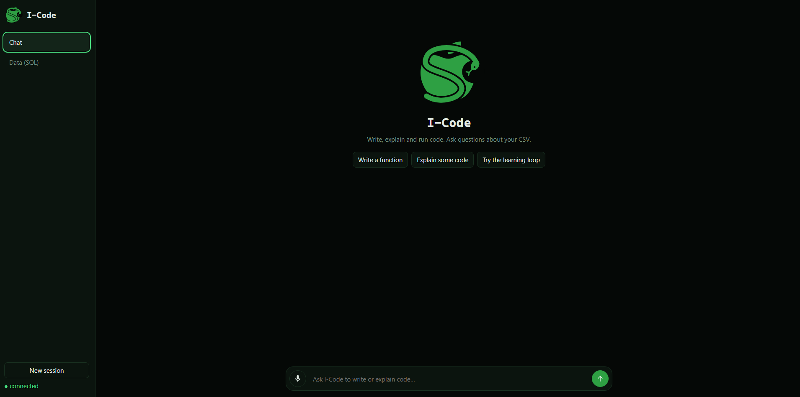
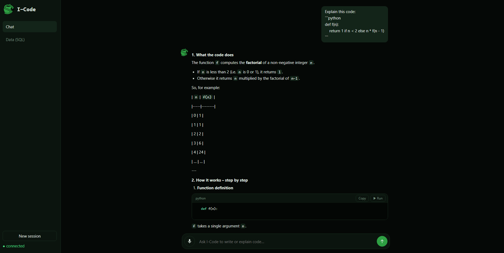
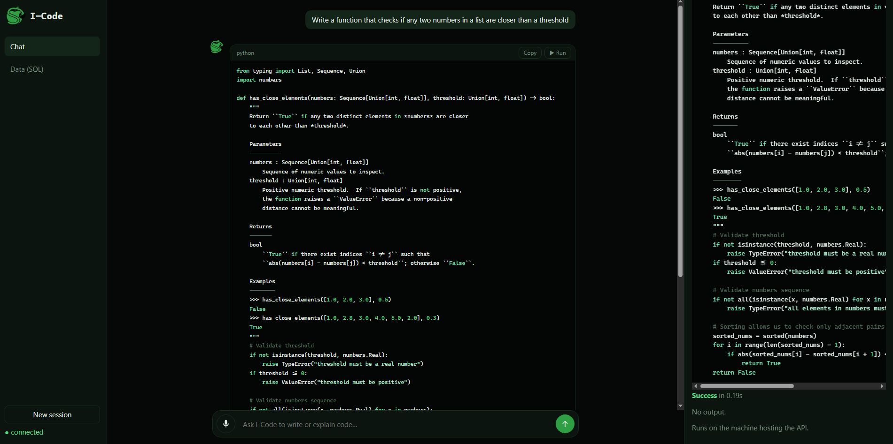
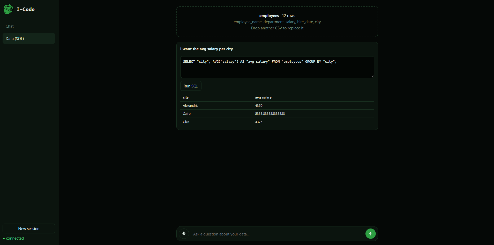
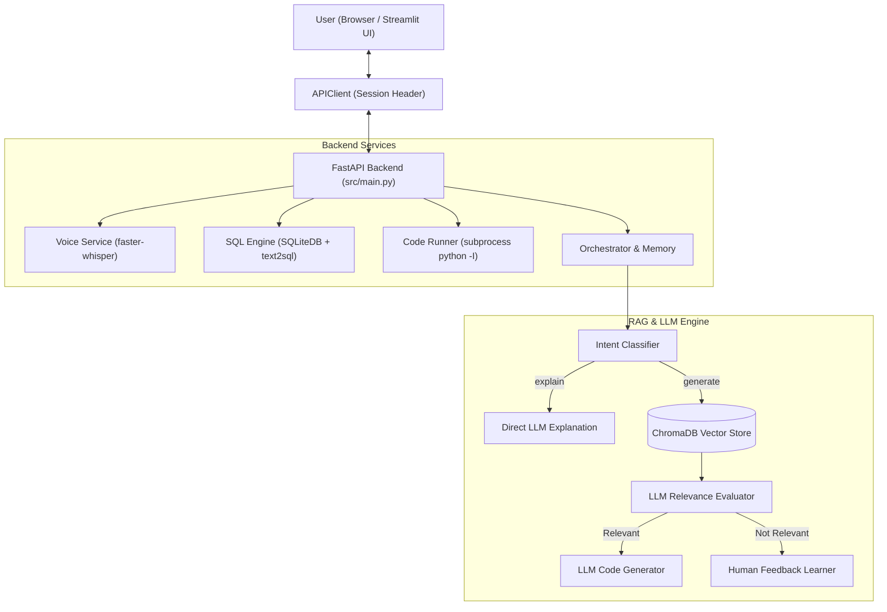

# I-Code — AI Coding Mentor & Pair Programmer

An intelligent coding assistant built with **Python**, **FastAPI**, **Streamlit**, **ChromaDB**, **SQLite**, **faster-whisper**, and **LLMs**.

I-Code helps developers understand, write, and execute code, as well as query data using natural language. It features a decoupled client-server architecture: a high-performance **FastAPI backend** manages LLM routing, RAG retrieval, speech transcription, database querying, and code execution, while a modern dark-themed **Streamlit frontend** provides a responsive pair-programming workspace.

---

## Key Features

- **Intent-Driven Routing**: Distinguishes code explanation from code generation, routing explanation requests directly to the LLM without retrieval overhead.
- **RAG with Relevance Guardrail**: Retrieves reference problems from ChromaDB (HumanEval) and uses an LLM evaluator to verify context relevance before generating code.
- **Text-to-SQL Data Assistant**: Upload any CSV file directly into an in-memory SQLite database, ask analytical questions using text or voice, review the generated SQL, and execute it to inspect tabular results.
- **Voice Input & Whisper Transcription**: Speak programming prompts or data queries directly through microphone recording or audio uploads, transcribed locally using `faster-whisper`.
- **Safe Subprocess Code Runner**: Executes Python snippets in an isolated subprocess (`python -I`) with stripped environment variables (protecting API keys), configurable timeouts, and output truncation.
- **Dynamic Human Feedback Learning**: When the system lacks relevant knowledge for a request, it prompts the user for a reference implementation and indexes it dynamically into ChromaDB.
- **Conversational Memory**: Maintains multi-turn context with recent verbatim exchanges and periodic LLM-driven background summarization.
- **Client-Server Architecture**: Fully decoupled FastAPI REST backend and Streamlit UI connected via a session-aware `APIClient`.

---

## Visual Walkthrough & Demos



### 1. Explain Code
Walk through existing logic, debug issues, and receive line-by-line code explanations directly from the LLM without RAG overhead.




---

### 2. Generate Code & Inline Execution
Retrieve reference problems from ChromaDB, verify relevance, generate clean Python implementations, and execute them with the inline **▶ Run Code** button.



---

### 3. Text to SQL Workspace
Upload a CSV dataset, speak or type analytical queries, inspect the generated SQL statement, and run it to display formatted data tables.



---

## Architecture



---

## Quick Start

### 1. Clone & Set Up Virtual Environment

**Linux / macOS:**
```bash
python3 -m venv .venv
source .venv/bin/activate
```

**Windows (PowerShell):**
```powershell
python -m venv .venv
.\.venv\Scripts\Activate.ps1
```

### 2. Install Dependencies
```bash
pip install -r requirements.txt
```

### 3. Configure Environment Variables
Copy `.env.example` to `.env`:
```bash
cp .env.example .env
```

Set your API credentials in `.env`:
```env
# NVIDIA NIM (default in src/llm.py)
NVIDIA_API_KEY=your_api_key_here
NVIDIA_BASE_URL=https://integrate.api.nvidia.com/v1
NVIDIA_MODEL=meta/llama-3.1-8b-instruct

# Backend API URL (for Streamlit frontend)
API_BASE_URL=http://localhost:8000

# Or OpenRouter / Gemini:
# OPENROUTER_API_KEY=your_key_here
# GEMINI_API_KEY=your_key_here
```

### 4. Download Data & Ingest Knowledge Base
Run these two scripts once from the project root:

```bash
# 1. Download HumanEval dataset (164 problems)
python -m scripts.download_data

# 2. Ingest and embed into ChromaDB
python -m scripts.ingest
```

### 5. Launch the Application

Start the **FastAPI backend** in your first terminal:
```bash
uvicorn src.main:app --reload --port 8000
```

Start the **Streamlit frontend** in a second terminal:
```bash
streamlit run src/app.py
```

---

## Backend API Endpoints

| Endpoint | Method | Description |
| :--- | :--- | :--- |
| `/sessions` | `POST` | Create a new isolated user session. |
| `/sessions/{sid}` | `DELETE` | Drop and clean up an existing session. |
| `/analyze` | `POST` | Classify user intent (`explain`, `generate`, `clarify`). |
| `/explain` | `POST` | Generate code explanations directly via LLM. |
| `/generate` | `POST` | RAG-augmented code generation with ChromaDB retrieval. |
| `/feedback` | `POST` | Ingest user-provided solutions for unhandled problems. |
| `/run` | `POST` | Execute Python code inside an isolated subprocess sandbox. |
| `/sql/upload` | `POST` | Upload and sanitize a CSV file into SQLite. |
| `/sql/query` | `POST` | Convert a natural-language question into an executable SQL query. |
| `/sql/execute` | `POST` | Run an approved SQL query and return formatted table results. |
| `/voice/transcribe` | `POST` | Upload an audio file and transcribe to text via Whisper. |
| `/voice/start` | `POST` | Begin recording audio on the server microphone. |
| `/voice/stop` | `POST` | Stop server recording and return the transcript. |

---

## Project Structure

```text
I-Code/
├── data/humaneval/         # HumanEval dataset (downloaded on setup)
├── chroma_db/              # Local ChromaDB vector storage (generated on ingest)
├── docs/images/            # Screenshots and visual walkthrough assets
├── scripts/
│   ├── download_data.py    # Downloads dataset from Hugging Face
│   ├── ingest.py           # Ingests problems into ChromaDB
│   ├── try_llm.py          # Quick LLM connectivity test
│   ├── try_generate.py     # Tests RAG retrieval and generation
│   ├── try_feedback.py     # Tests human feedback learning loop
│   ├── try_sql.py          # Tests SQL conversion and SQLite execution
│   └── try_code_runner.py  # Tests subprocess execution and safety limits
├── src/
│   ├── app.py              # Streamlit frontend UI
│   ├── api_client.py       # Session-aware HTTP client for FastAPI backend
│   ├── main.py             # FastAPI backend REST API server
│   ├── orchestrator.py     # Workflow coordinator (routing, RAG, feedback)
│   ├── llm.py              # LLM client (completion, classification, text2sql)
│   ├── retriever.py        # ChromaDB search and text chunking
│   ├── sql.py              # In-memory SQLite engine and schema inspector
│   ├── voice.py            # Local Whisper speech-to-text integration
│   ├── memory.py           # Multi-turn memory with rolling LLM summarization
│   ├── code_runner.py      # Subprocess execution sandbox with timeout
│   ├── sessions.py         # Multi-session store for backend state
│   └── config.py           # Centralized paths, prompts, and settings
├── requirements.txt        # Pinned core dependencies
└── README.md
```

---

## Core Configuration

Key settings in [`src/config.py`]

| Setting | Default | Purpose |
| :--- | :--- | :--- |
| `API_BASE_URL` | `"http://localhost:8000"` | Base URL for FastAPI server |
| `COLLECTION_NAME` | `"knowledge"` | ChromaDB vector collection name |
| `TOP_K` | `3` | Number of reference examples retrieved for RAG |
| `CHUNK_THRESHOLD` | `2500` | Character limit before a document is chunked |
| `RUN_TIMEOUT` | `10` | Code runner execution timeout in seconds |
| `MAX_OUTPUT_CHARS`| `5000` | Max characters captured from script stdout/stderr |
| `MEMORY_MAX_MESSAGES` | `10` | Number of recent messages kept verbatim |
| `MEMORY_SUMMARY_BATCH` | `4` | Number of excess messages before running LLM summarization |
| `WHISPER_MODEL` | `"small"` | Whisper model size (`tiny`, `base`, `small`, etc.) |

---

## Next Steps & Roadmap

### Known Limitations
- **Subprocess vs. Container Sandbox**: The execution tool runs in a subprocess (`python -I`) with stripped environment variables and a timeout, but does not provide complete OS kernel isolation (like Docker or gVisor).
- **Single-Table SQLite**: The SQL workspace currently processes one loaded CSV table at a time.
- **Unverified Feedback Ingestion**: User-provided code solutions are stored directly in ChromaDB without automated unit test verification.
- **Upstream Latency & Rate Limits**: Response speed and token quotas depend on the external LLM provider.

### Planned Improvements
- **Response Streaming**: Add streaming tokens in both FastAPI and Streamlit for lower perceived latency.
- **Multi-Table Relational Schema**: Support uploading multiple CSVs with join inference and relational foreign key querying.
- **Pre-Ingestion Test Validation**: Automatically test user-submitted code in the runner before committing it to ChromaDB.
- **Containerized Sandbox**: Wrap the code execution tool in an isolated Docker container for strict filesystem and network isolation.
- **Multi-Language Runner**: Support running languages beyond Python (e.g., JavaScript, Go, Rust).
