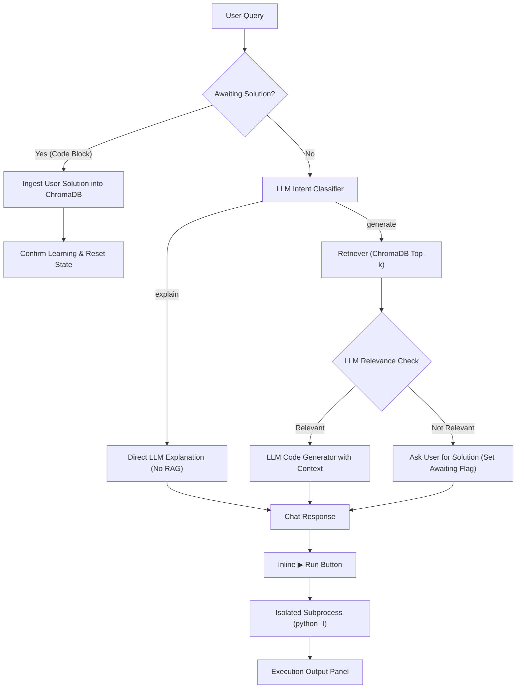

# I-Code — AI Coding Mentor & Pair Programmer

An intelligent coding assistant built with **Python**, **Streamlit**, **ChromaDB**, and **LLMs**.

I-Code helps developers understand and write code. It classifies user queries to either explain code directly (without RAG overhead) or generate solutions using Retrieval-Augmented Generation (RAG) over a ChromaDB database of programming tasks. When relevant reference code is missing, it invites the user to provide a working solution and learns it dynamically for future requests. It also includes an isolated subprocess code execution tool to run generated Python code directly from the chat UI.

---

## Key Features

- **Smart Intent Routing**: Classifies inputs into `explain` (direct LLM analysis) or `generate` (retrieval-augmented generation).
- **RAG with Relevance Guardrail**: Retrieves reference problems from ChromaDB and uses an LLM evaluator to check context relevance before generating code.
- **Human Feedback Learning Loop**: If retrieved context is not relevant, the assistant asks for the correct solution and dynamically indexes it into ChromaDB.
- **Conversation Memory**: Keeps recent dialogue turns verbatim and uses the LLM to compress older history into a running summary.
- **Safe Subprocess Runner**: Executes Python code in a separate process (`python -I`) with stripped environment variables (protecting API keys), timeouts, and output truncation.
- **Streamlit Web UI**: Chat interface with syntax highlighting, language/framework dropdowns, and an inline **▶ Run** button opening a side-by-side execution panel.

---

## Architecture



---

## Quick Start

### 1. Clone & Set Up Virtual Environment

**Linux / macOS:**
```bash
python3 -m venv .venv
source .venv/bin/activate
```

**Windows (PowerShell):**
```powershell
python -m venv .venv
.\.venv\Scripts\Activate.ps1
```

### 2. Install Dependencies
```bash
pip install -r requirements.txt
```

### 3. Configure Environment Variables
Copy `.env.example` to `.env`:
```bash
cp .env.example .env
```

Add your API key to `.env`:
```env
# NVIDIA NIM (default in src/llm.py)
NVIDIA_API_KEY=your_api_key_here
NVIDIA_BASE_URL=https://integrate.api.nvidia.com/v1
NVIDIA_MODEL=meta/llama-3.1-8b-instruct

# Or OpenRouter:
# OPENROUTER_API_KEY=your_key_here
```

### 4. Download Data & Ingest Knowledge Base
Run these two scripts once from the project root:

```bash
# 1. Download HumanEval dataset (164 problems)
python -m scripts.download_data

# 2. Ingest and embed into ChromaDB
python -m scripts.ingest
```

### 5. Run the Application
```bash
streamlit run src/app.py
```

---

## Project Structure

```text
I-Code/
├── data/humaneval/         # HumanEval dataset (downloaded on setup)
├── chroma_db/              # Local ChromaDB vector storage (generated on ingest)
├── scripts/
│   ├── download_data.py    # Downloads dataset from Hugging Face
│   ├── ingest.py           # Ingests problems into ChromaDB
│   ├── try_llm.py          # Quick LLM connectivity test
│   ├── try_generate.py     # Tests RAG retrieval and generation
│   ├── try_feedback.py     # Tests human feedback learning loop
│   └── try_code_runner.py  # Tests subprocess execution and safety limits
├── src/
│   ├── app.py              # Streamlit chat interface and runner drawer
│   ├── config.py           # Centralized paths, prompts, and settings
│   ├── llm.py              # LLM client (completion, classification, evaluation)
│   ├── retriever.py        # ChromaDB search and text chunking
│   ├── memory.py           # Multi-turn memory with rolling LLM summarization
│   ├── orchestrator.py     # Core workflow coordinator (routing, RAG, feedback)
│   └── code_runner.py      # Subprocess execution sandbox with timeout
├── requirements.txt        # Pinned core dependencies
└── README.md
```

---

## Core Configuration

Key settings in [`src/config.py`](file:///c:/Users/Hamza%20Eldafrawy/Desktop/Cellula_Intern/I-Code/src/config.py):

| Setting | Default | Purpose |
| :--- | :--- | :--- |
| `COLLECTION_NAME` | `"knowledge"` | ChromaDB vector collection name |
| `TOP_K` | `3` | Number of reference examples retrieved for RAG |
| `CHUNK_THRESHOLD` | `2500` | Character limit before a document is chunked |
| `RUN_TIMEOUT` | `10` | Code runner execution timeout in seconds |
| `MAX_OUTPUT_CHARS`| `5000` | Max characters captured from script stdout/stderr |
| `MEMORY_MAX_MESSAGES` | `10` | Number of recent messages kept verbatim |
| `MEMORY_SUMMARY_BATCH` | `4` | Number of excess messages before running LLM summarization |

---

## Next Steps

### Known Limitations
- **Python-Only Knowledge Base & Runner**: The default knowledge base is HumanEval (Python algorithmic problems), and the code execution tool only runs Python scripts via `sys.executable`.
- **Subprocess vs. Container Sandbox**: The execution tool runs in a subprocess (`python -I`) with stripped environment variables and a timeout, but does not provide complete OS kernel isolation (like Docker or gVisor).
- **Unverified Feedback Ingestion**: User-provided code solutions are stored directly in ChromaDB without automated syntax verification or unit testing.
- **Upstream Latency & Rate Limits**: Response speed and availability depend entirely on the external LLM provider.

### Planned Improvements
- **Response Streaming**: Add streaming tokens in the Streamlit UI for lower perceived latency.
- **Multi-Language Support**: Extend retrieval, code generation, and the execution runner to support JavaScript, TypeScript, Go, and Rust.
- **Pre-Ingestion Testing**: Automatically run and validate user-submitted code in the runner before committing it to ChromaDB.
- **Multi-File Context & File Upload**: Allow uploading repository files in Streamlit for whole-project debugging and explanations.
- **Containerized Sandbox**: Wrap the code execution tool in an isolated Docker container for strict filesystem and network isolation.

---

## Next Steps

### Known Limitations
- **Python-Only Knowledge Base & Runner**: The default knowledge base is HumanEval (Python algorithmic problems), and the code execution tool only runs Python scripts via `sys.executable`.
- **Subprocess vs. Container Sandbox**: The execution tool runs in a subprocess (`python -I`) with stripped environment variables and a timeout, but does not provide complete OS kernel isolation (like Docker or gVisor).
- **Unverified Feedback Ingestion**: User-provided code solutions are stored directly in ChromaDB without automated syntax verification or unit testing.
- **Upstream Latency & Rate Limits**: Response speed and availability depend entirely on the external LLM provider.

### Planned Improvements
- **Response Streaming**: Add streaming tokens in the Streamlit UI for lower perceived latency.
- **Multi-Language Support**: Extend retrieval, code generation, and the execution runner to support JavaScript, TypeScript, Go, and Rust.
- **Pre-Ingestion Testing**: Automatically run and validate user-submitted code in the runner before committing it to ChromaDB.
- **Multi-File Context & File Upload**: Allow uploading repository files in Streamlit for whole-project debugging and explanations.
- **Containerized Sandbox**: Wrap the code execution tool in an isolated Docker container for strict filesystem and network isolation.

